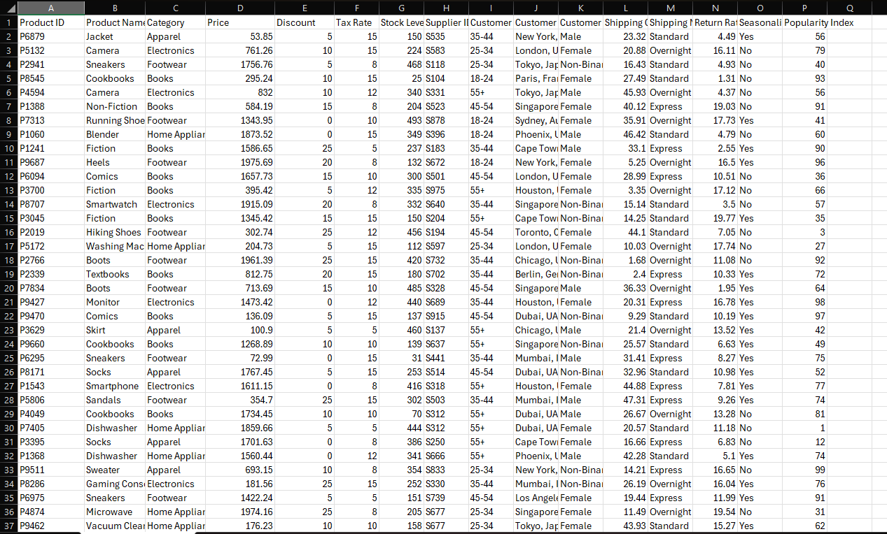
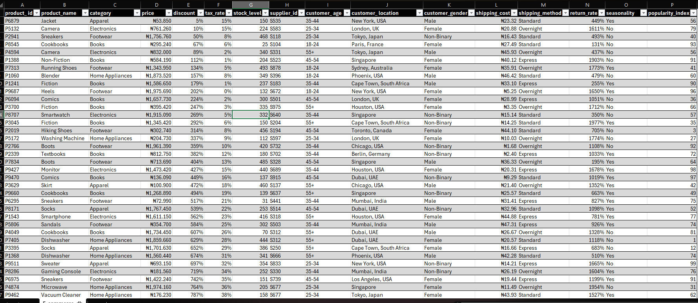
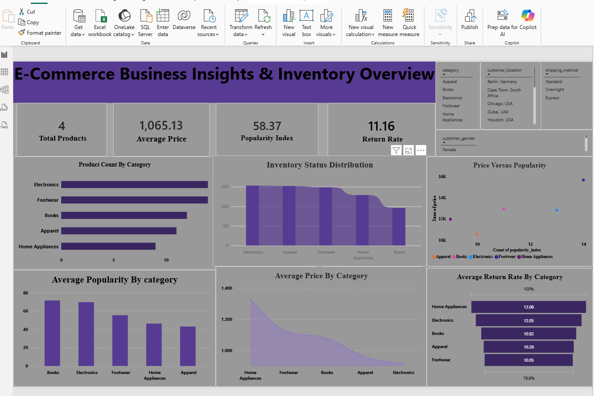

# E-Commerce Customer and Operations Analysis

## 📊 Project Overview
This end-to-end data analytics project explores online retail performance,
customer purchasing behavior, and inventory risk.


## 📌 Introduction
E-commerce businesses generate high volumes of transactional, customer, and inventory data every day, yet raw operational exports often suffer from formatting inconsistencies, missing values, and unmonitored stock risks. This project presents an end-to-end data analytics workflow that transforms messy online retail records into clean, structured datasets and an interactive business intelligence dashboard.

## 🎯 Aim
The primary aim of this project is to clean, model, and analyze e-commerce operational data to uncover actionable insights into product performance, customer purchasing behavior, shipping efficiency, and inventory stockout risks.


## 🎯 Objectives
- Audit and clean raw data in Excel
- Transform and analyze data with SQL
- Build an interactive Power BI dashboard
- Identify customer, product, shipping, and inventory insights

## 🛠️ Tech Stack
- Microsoft Excel
- SQL
- Power BI
- Git and GitHub

## 📁 Repository Structure
```text
├── excel_folder/
│   ├── excel-before-cleaning.png
│   └── excel-after-cleaning.png
├── powerbi/
│   └── ecommerce-dashboard.png
├── sql/
│   └── ecommerce_analysis.sql
└── README.md
```

## 🔍 Key Insights
1. Identified leading product categories.
2. Located high-demand products with low inventory.
3. Compared shipping methods and return rates.

## 🧹 Data Cleaning and Audit
**Before cleaning:**


**After cleaning:**


## Dashboard Preview


## 🚀 How to View This Project
- Review SQL cleaning and analysis scripts in the sql/ folder.
- Open the Power BI .png from the powerbi/ folder.
- Preview dashboard powerbi/ecommerce-dashboard.png.

## Recommendations & Limitations

### Recommendations
- **Prioritize High-Risk Inventory Restocks:** Replenish products flagged as `High Risk` (`stock_level <= 10` and `popularity_index >= 75`) first to avoid stockouts on popular items.
- **Optimize Shipping & Return Trade-Offs:** Audit shipping methods with high average shipping costs or elevated return rates to reduce operational drag.
- **Refine Category & Discount Strategy:** Align promotional discounts and stock allocation with top-performing categories and customer demand.
- **Strengthen Input Validation:** Apply range checks on price, stock level, return rate, and customer age at the source to minimize cleaning overhead.

### Limitations
- **Point-in-Time Data:** Insights are based on the available dataset snapshot and do not track ongoing real-time changes.
- **Custom Risk Thresholds:** Stockout risk classifications depend on set numeric cutoffs (`<= 10` stock and `>= 75` popularity) that may vary by product line.
- **Observational Scope:** Findings show associations across attributes rather than causal proof.
- **Upload Size Constraints:** Oversized raw data or dashboard files outside GitHub's browser upload limits are summarized through audit logs, SQL views, and visual previews.

## Author

Created by **Ajayi Abigail Omobolanle**

- GitHub: [GitHub Profile](https://github.com/AbigailAjayi)
- LinkedIn: [LinkedIn Profile](https://www.linkedin.com/in/ajayi-abigail-omobolanle/)
- Email: [abigailajayi303@gmail.com]
